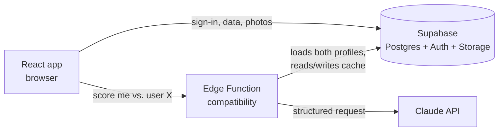

# ColocsMTL

**Find a roommate you'll actually get along with, in Montreal.**

ColocsMTL matches people by how they live, not just by budget. That means sleep schedule, cleanliness, noise, guests, pets, smoking and shared interests. Claude AI scores each pair's compatibility, and when two people like each other they can chat and find a place together.

<!-- Add a link to the live site here once it's deployed, e.g.:
**Live:** https://colocsmtl.ca
-->

<!-- Add screenshots here, e.g.:


-->

## Features

- **Lifestyle profiles.** A guided setup covers budget, preferred neighborhoods, move-in date, daily habits and "vibe" tags.
- **AI compatibility scores.** Claude rates each candidate from 0 to 100, with a breakdown for lifestyle, schedule, cleanliness, social habits and interests. Candidates are sorted best fit first.
- **Matching and chat.** Like or pass on profiles. When the like is mutual, a private conversation opens.
- **Room listings.** Post a room with photos, amenities, house rules and current roommates, and browse with search, neighborhood and price filters.
- **Neighborhood guide.** Compare Montreal neighborhoods, from the Plateau and Mile End to Verdun and Griffintown, with live listing counts.

## Tech stack

| Layer | Technology |
|---|---|
| Frontend | React 18, Vite, React Router, Tailwind CSS, shadcn/ui, Framer Motion |
| Backend | Supabase: Postgres, Auth, Storage, Edge Functions |
| AI | Claude (`claude-opus-5-5`) through the Anthropic TypeScript SDK, with structured JSON output |
| Hosting | Any static host, or Docker with nginx |

## Architecture



**Security comes from the database, not the frontend.** Every table has row-level security policies in [`supabase/migrations`](supabase/migrations). Users can only:
- edit their own profile and listings,
- read their own matches and messages,
- send messages inside a mutual match,
- upload photos to their own storage folder.

Users also can't mark themselves verified or premium. The Anthropic API key exists only as a Supabase secret and never reaches the browser.

**Compatibility scoring is cheap and hard to abuse.** The browser sends only the other person's email. The Edge Function checks the caller is signed in and loads both profiles itself, so the endpoint can't be used as a general AI proxy. Claude's output is checked against a Zod schema. Results are cached per pair and only recalculated when either profile's matching fields change. If Claude declines a request, the API retries it on a fallback model, and if scoring fails the app shows a neutral score.

## Project layout

```
src/
  api/client.js            Data layer: auth, tables, uploads, compatibility
  api/supabaseClient.js    Supabase connection (reads .env.local)
  entities/*.json          Field definitions for each table
  pages/                   One file per page
  components/              Shared components (ui/ is shadcn/ui)
supabase/
  migrations/              Tables, row-level security, storage bucket
  functions/compatibility/ Edge Function that asks Claude for a score
```

## Running it yourself

You need Node 20+, the [Supabase CLI](https://supabase.com/docs/guides/cli) and an [Anthropic API key](https://console.anthropic.com/).

1. **Create a Supabase project** at <https://supabase.com/dashboard> (the free tier works).
2. **Link it and create the database:**
   ```bash
   supabase init      # creates supabase/config.toml; keeps the existing migrations and functions
   supabase login
   supabase link --project-ref <your-project-ref>
   supabase db push
   ```
3. **Deploy the compatibility function:**
   ```bash
   supabase secrets set ANTHROPIC_API_KEY=sk-ant-...
   supabase functions deploy compatibility
   ```
4. **Configure the app:**
   ```bash
   cp .env.example .env.local   # then fill in VITE_SUPABASE_URL and VITE_SUPABASE_ANON_KEY
   ```
   Both values are under Project Settings → API in the Supabase dashboard.
5. **Configure sign-in.** In the Supabase dashboard, go to Authentication → URL Configuration and set the Site URL to where the app runs, for example `http://localhost:5173`. Email confirmation is on by default; for local testing you can turn it off under Sign In / Providers → Email.
6. **Run it:**
   ```bash
   npm install
   npm run dev        # http://localhost:5173
   ```

### Deploying

`npm run build` outputs a static site in `dist/`. Host it anywhere that serves static files (Netlify, Vercel, Cloudflare Pages, nginx), and send unknown paths to `index.html`.

The production domain is **colocsmtl.ca**. When you deploy, go to the Supabase dashboard → Authentication → URL Configuration and set the Site URL to `https://colocsmtl.ca`. Add `http://localhost:5173` under Redirect URLs so local development still works.

To use Docker instead:

```bash
docker build \
  --build-arg VITE_SUPABASE_URL=https://xxxx.supabase.co \
  --build-arg VITE_SUPABASE_ANON_KEY=... \
  -t colocsmtl .
docker run -p 8080:80 colocsmtl
```

## Roadmap

- [ ] Listing detail page
- [ ] Account deletion and data export (needed for Quebec's privacy law, Law 25)
- [ ] Privacy policy and terms
- [ ] Real-time chat with Supabase Realtime, replacing the current polling
- [ ] Profile verification

## License

Copyright © 2026 Juan. All rights reserved. The source is public so it can be viewed as part of a portfolio. See [LICENSE](LICENSE).
